<p align="center">
  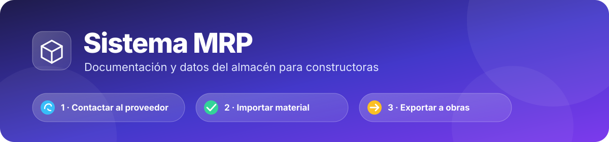
</p>

<p align="center">
  
  
  
  
  <a href="https://github.com/InmobiliariaPolyline/Sistema-MRP-EDC-VII/actions/workflows/tests.yml"></a>
  
  
</p>

<p align="center">
  <b>📦 Compras · 🏬 Almacén · 🏗️ Obras</b><br>
  Una herramienta para <b>preparar documentación y gestionar los datos del almacén</b> de una constructora.<br>
  Sin servicios reales conectados: no envía mensajes por sí sola, no compra y no paga.
</p>

<p align="center">
  <a href="#-objetivos">🎯 Objetivos</a> ·
  <a href="#-el-sistema-en-imágenes">🎨 Imágenes</a> ·
  <a href="#-flujo-de-trabajo">🔄 Flujo</a> ·
  <a href="#-módulos">🧩 Módulos</a> ·
  <a href="#-documentos-pdf">📄 PDF</a> ·
  <a href="#-arquitectura">🏢 Arquitectura</a> ·
  <a href="#-puesta-en-marcha">🚀 Puesta en marcha</a> ·
  <a href="MEJORAS.md">🗺️ Hoja de ruta</a> ·
  <a href="CHANGELOG.md">📜 Cambios</a>
</p>

---

## 🎯 Objetivos

| | Objetivo | Qué hace el sistema |
|:-:|---|---|
| 📞 | **1 · Contactar con el proveedor** | Guarda sus datos, su catálogo y sus precios; abre **llamada, WhatsApp, Gmail u Outlook** con el mensaje ya escrito (pedir catálogo, cotizar, enviar la orden). |
| 📥 | **2 · Importar material al almacén** | Orden de compra → **recepción** parcial o total → **entrada al inventario**. También importa listas de precios desde Excel o CSV. |
| 📤 | **3 · Exportar material a las obras** | **Despacho** del almacén a la obra con su **vale de salida en PDF**, controlando el presupuesto de la obra. |

> **Versión vigente:** la ves al pie del menú lateral («Sistema MRP · parche NNN», `core/version.py`).
> **Qué falta y qué se puede mejorar:** [MEJORAS.md](MEJORAS.md) · **Historial de parches:** [CHANGELOG.md](CHANGELOG.md).

## ✅ Qué hace y ❌ qué no hace

| ✅ Sí hace | ❌ No hace |
|---|---|
| Prepara cada pedido con su **valor exacto (IGV 18 %)** antes de comprar. | No se conecta con el sistema ni la base de datos del proveedor. |
| Registra **lo pedido**, **lo recibido** y **lo despachado** a cada obra. | No hace la compra ni **maneja dinero** (nada de tarjetas ni cuentas). |
| Calcula el **cronograma de cuotas** (informativo) y genera su PDF. | No envía correos ni mensajes por sí solo: **tú** abres el enlace y lo mandas. |
| Genera **PDF** (órdenes, vales, pedidos, reportes, kardex) y **Excel**. | No factura ni emite comprobantes electrónicos. |
| Guarda el historial de **quién cambió qué** y respaldos cifrados. | Un solo administrador y un solo almacén. |

Las cifras son siempre «valor de los pedidos», nunca «pérdida» ni «pagado».

## 🎨 El sistema en imágenes

<table>
  <tr>
    <td width="50%">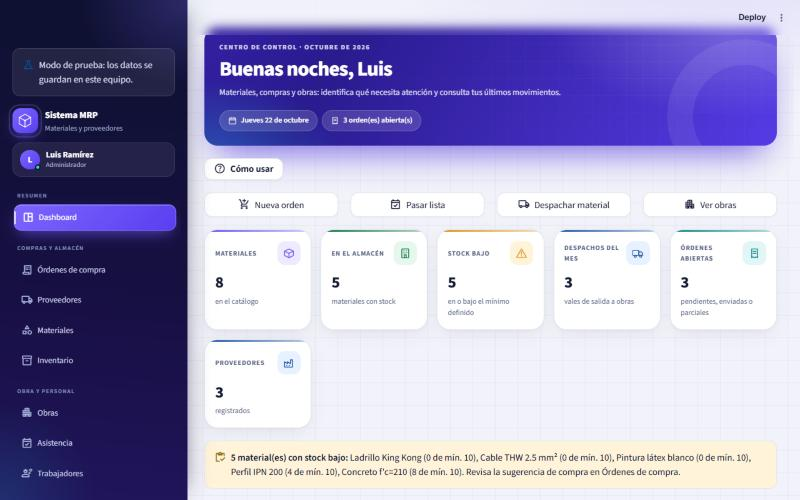<br><sub><b>📊 Dashboard</b>: totales, alertas de stock bajo y accesos rápidos.</sub></td>
    <td width="50%">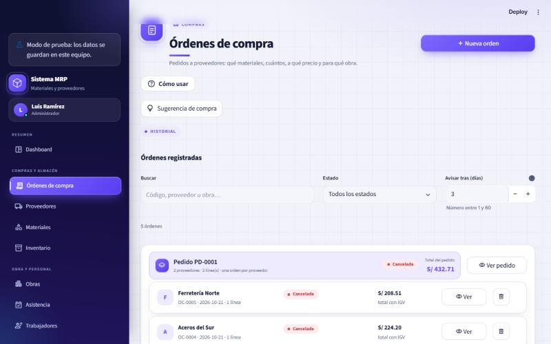<br><sub><b>🧾 Órdenes de compra</b>: un pedido con varios proveedores aparece como una sola tarjeta.</sub></td>
  </tr>
  <tr>
    <td width="50%">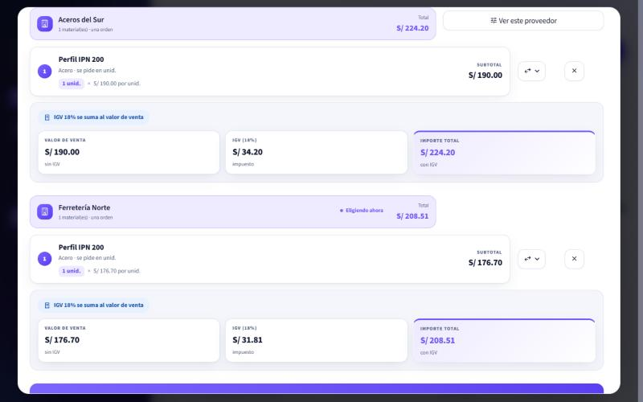<br><sub><b>🛒 Nuevo pedido</b>: una tarjeta por proveedor, con su IGV, su plan de pagos y el total.</sub></td>
    <td width="50%">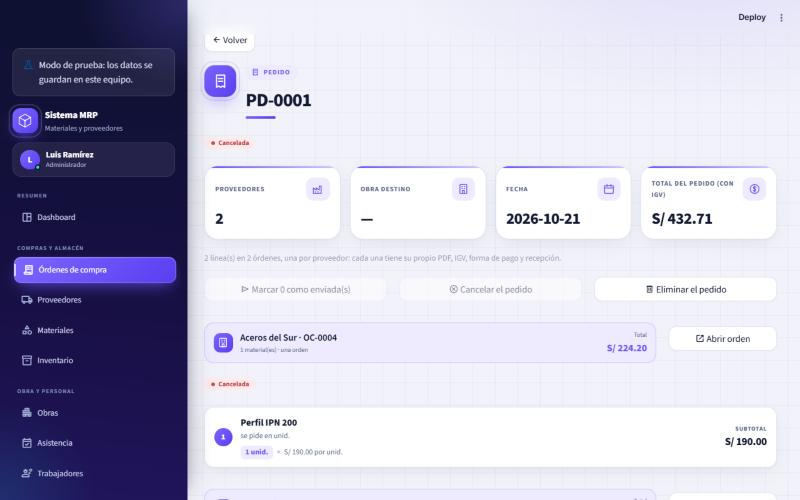<br><sub><b>📦 Ficha del pedido (PD-)</b>: estado resumen y acciones sobre todas sus órdenes.</sub></td>
  </tr>
  <tr>
    <td width="50%">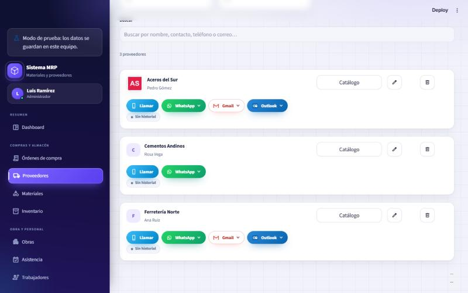<br><sub><b>🏭 Proveedores</b>: logotipo y contacto con Llamar, WhatsApp, Gmail y Outlook.</sub></td>
    <td width="50%">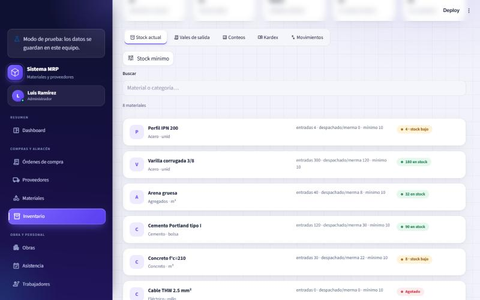<br><sub><b>🏬 Inventario</b>: stock por material con alerta de stock mínimo.</sub></td>
  </tr>
  <tr>
    <td colspan="2" align="center">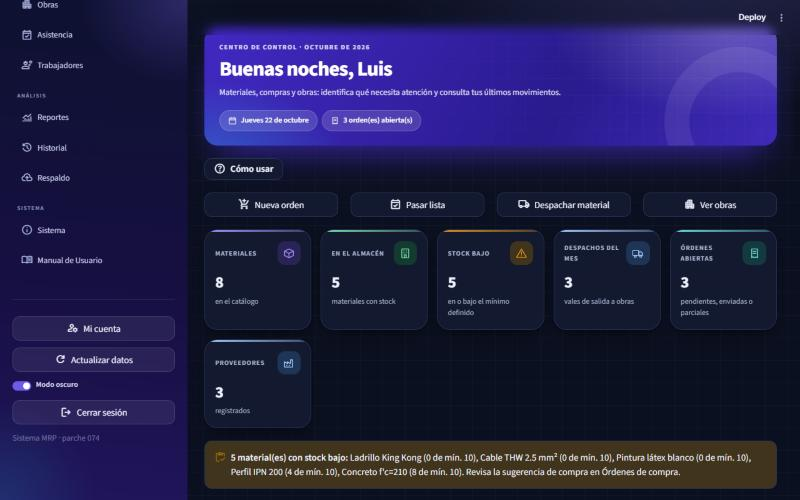<br><sub><b>🌙 Modo oscuro</b>: todo el sistema tiene tema claro y oscuro, en hora de Lima.</sub></td>
  </tr>
</table>

## 🔄 Flujo de trabajo

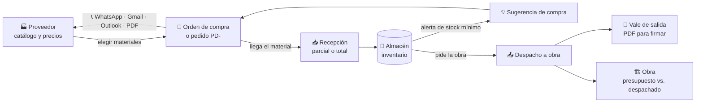

## 🧩 Módulos

| | Módulo | Qué resuelve | Acceso |
|:-:|---|---|:-:|
| 📊 | **Dashboard** | Totales, gasto por mes y proveedor, órdenes por estado, alertas de atraso y de stock bajo, mapa de obras. | Todos |
| 🧾 | **Órdenes de compra** | Pedidos con IGV claro, **pago en cuotas**, **varios proveedores en un pedido**, comparador de cotizaciones, recepción parcial, duplicar, PDF y WhatsApp. | Todos |
| 🏭 | **Proveedores** | Ficha con logotipo, catálogo con precios y disponibilidad, **contacto rápido**, importar lista de precios, calificación por plazos. | Todos |
| 🧱 | **Materiales** | Catálogo maestro de 501 materiales: categoría, densidad, métrica, mejor precio. El stock no se edita aquí. | Todos |
| 🏬 | **Inventario** | Stock, movimientos, **despacho con vale de salida**, devoluciones, conteos físicos, kardex y stock mínimo. | Todos |
| 🏗️ | **Obras** | Presupuesto por obra y etapa frente a lo pedido, recibido y despachado; **edición de la obra**; mapa; reporte PDF. | Todos |
| 🗓️ | **Asistencia** | Pasar lista por día y resumen por trabajador y obra. | Todos |
| 👷 | **Trabajadores** | Personal, cuadrillas, obra asignada, ubicación y contacto por WhatsApp; acceso opcional al sistema. | Admin |
| 📈 | **Reportes** | 17 conjuntos descargables en Excel y PDF, más el reporte de obra. | Todos |
| 📖 | **Manual de Usuario** | Capítulos ilustrados con maquetas de cada formulario, buscador y glosario. | Todos |
| 🕘 | **Historial** | Quién creó, editó, recibió o eliminó qué, con el valor anterior y el nuevo. | Admin |
| 💾 | **Respaldo** | ZIP con un CSV por tabla, con cifrado AES-256 opcional. | Admin |

### 🧾 Lo nuevo en las órdenes de compra

| 💡 Función | Cómo funciona |
|---|---|
| **IGV en dos opciones** | «Sin IGV en el precio» (se suma 18 %) o «Con IGV incluido» (se separa del total). |
| **Pago en cuotas** | De 2 a 24 cuotas mensuales, quincenales o semanales, con inicial opcional. Calcula montos y vencimientos (informativo). |
| **PDF por pago** | Un aviso por cada cuota («OC-0008-P2») y el cronograma completo. |
| **Varios proveedores** | Cambiar de proveedor no pierde lo elegido; cada uno tiene sus condiciones; «Agregar desde aquí» y «Mover a otro proveedor» aprovechan el precio más bajo. |
| **Pedido PD-0001** | Al crearlo genera una orden por proveedor, mostrada como una sola ficha con el total general, su PDF y acciones conjuntas (enviar, cancelar, eliminar). |

## 📄 Documentos PDF

Seis temas de color, cinco estilos de portada, código de barras, sellos de estado y gráficos, todo con la fuente Inter incluida.

<table>
  <tr>
    <td width="33%" align="center">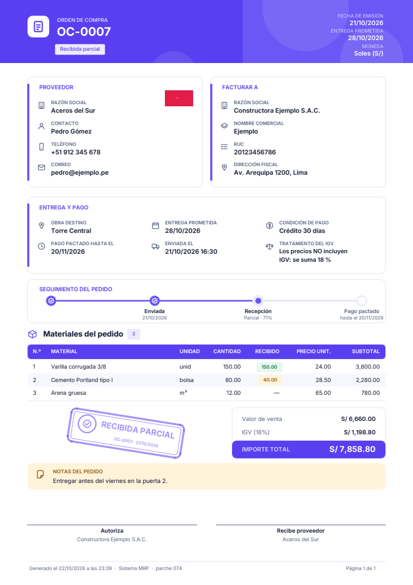<br><sub><b>🧾 Orden de compra</b></sub></td>
    <td width="33%" align="center">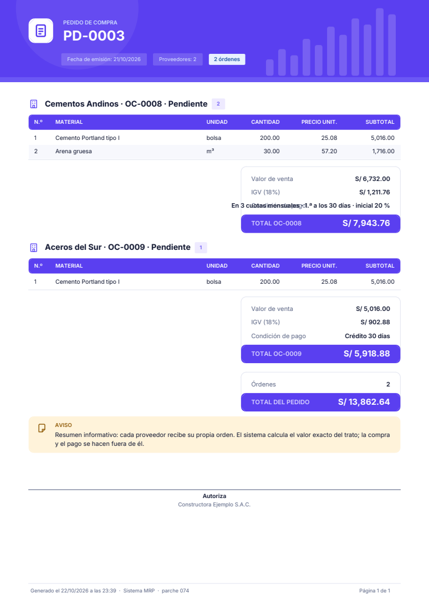<br><sub><b>📦 Pedido con varios proveedores</b></sub></td>
    <td width="33%" align="center">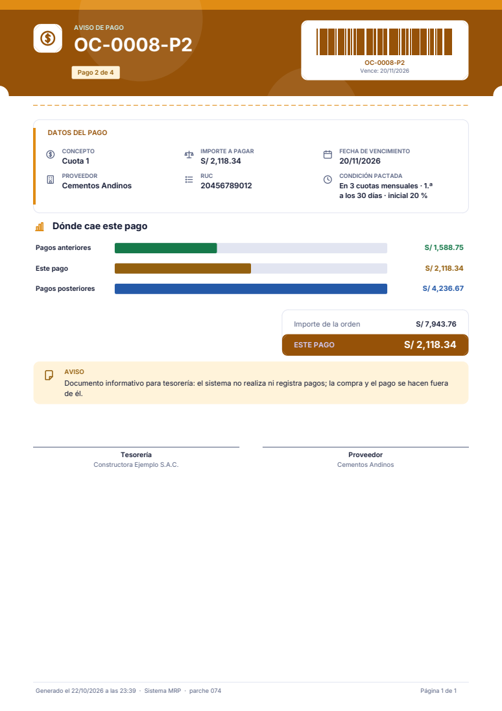<br><sub><b>🗓️ Aviso de pago (cuota)</b></sub></td>
  </tr>
  <tr>
    <td width="33%" align="center">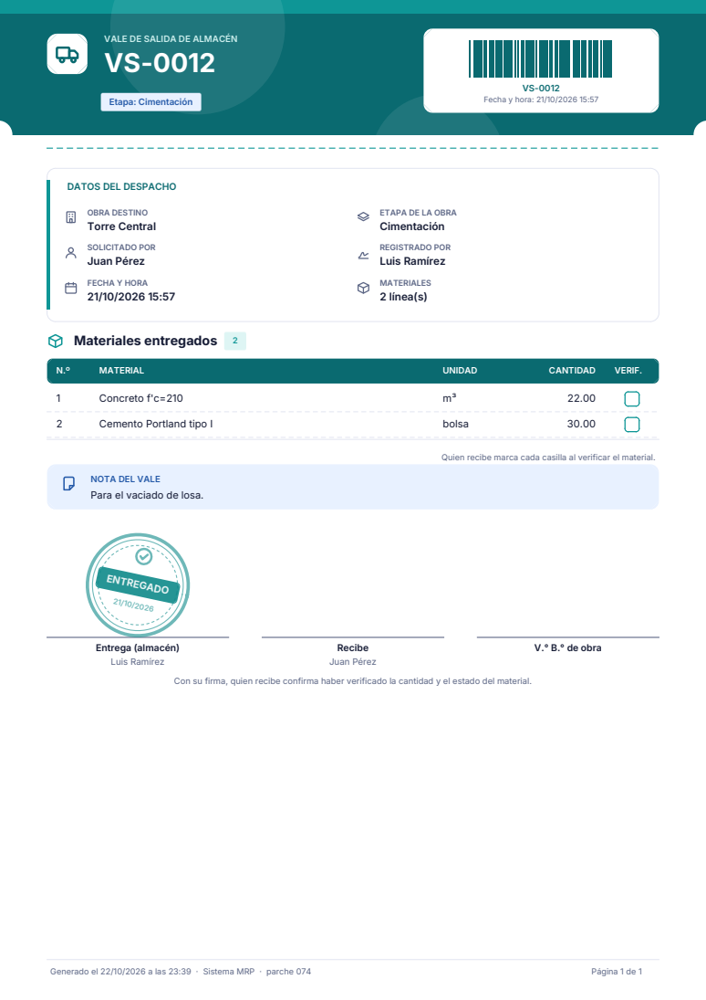<br><sub><b>🚚 Vale de salida</b></sub></td>
    <td width="33%" align="center">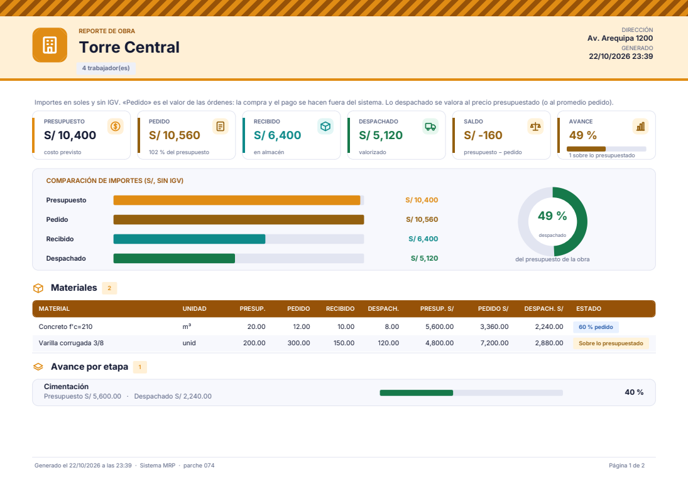<br><sub><b>🏗️ Reporte de obra</b></sub></td>
    <td width="33%" align="center">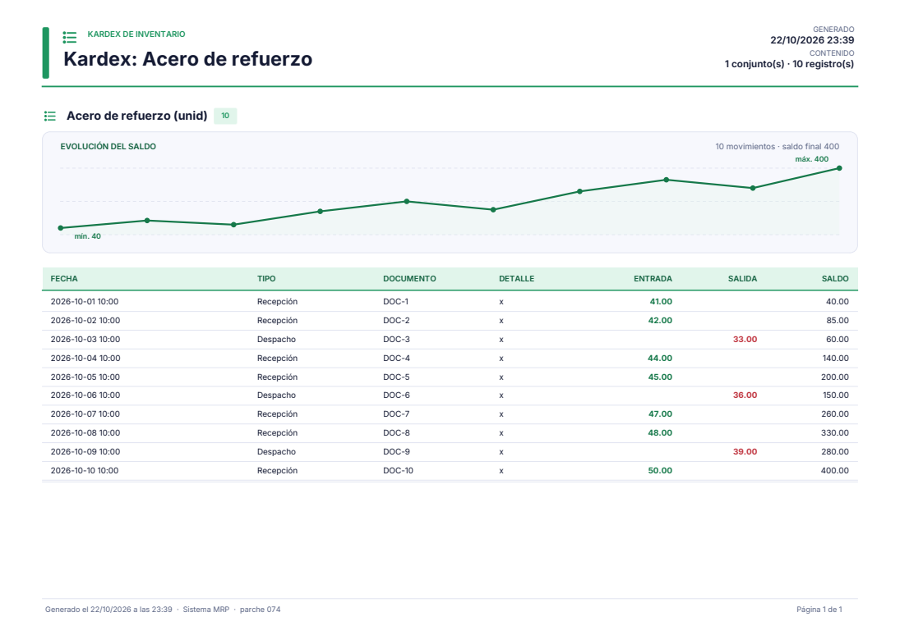<br><sub><b>📒 Kardex de inventario</b></sub></td>
  </tr>
</table>

## 🏢 Arquitectura

Streamlit **no separa frontend y backend**: es un solo proceso Python. Se organiza en capas, cada una en su carpeta.

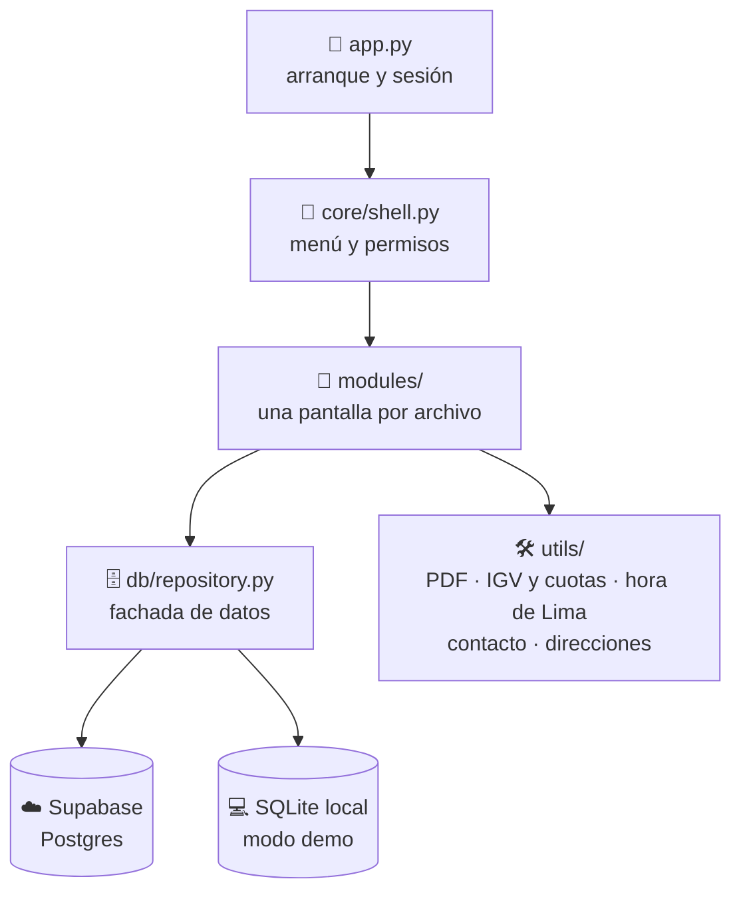

| Capa | Carpeta | Responsabilidad |
|---|---|---|
| 🚪 Arranque | `app.py` | Configura la página y exige sesión iniciada. |
| 🧭 Cascarón | `core/` | Menú lateral, permisos por rol y versión. |
| 🧩 Pantallas | `modules/` | Una pantalla por archivo; piden datos a `db/`, nunca a Supabase directo. |
| 🗄️ Datos | `db/` | Fachada que usa Supabase o SQLite según haya credenciales, esquema y migraciones. |
| 🛠️ Ayudas | `utils/` | PDF (`pdf_style.py`), dinero y cuotas (`money.py`), hora de Lima (`clock.py`), contacto, direcciones. |
| 🎨 Estilos | `modules/styles/` | Hojas CSS numeradas, paletas clara y oscura. |

**Stack:** Streamlit · Supabase (Postgres, `supabase-py`) · login propio con `bcrypt` · mapas con `st.map` y OpenStreetMap · `fpdf2` y `openpyxl` · caché de lecturas de 30 s.

## 🚀 Puesta en marcha

1. **Base de datos** — crea un proyecto en [Supabase](https://supabase.com) y corre `db/schema.sql` en el SQL Editor. Si actualizas una instalación existente, corre solo las migraciones de `db/migrations/` que falten (la última: `047_pedido_varios_proveedores.sql`).
2. **Dependencias** — `pip install -r requirements.txt`
3. **Credenciales** — copia `.env.example` a `.env` (o `.streamlit/secrets.toml.example` a `.streamlit/secrets.toml` si despliegas en Streamlit Community Cloud) y completa `SUPABASE_URL`, `SUPABASE_SERVICE_KEY` y `SESSION_SECRET`.
4. **Catálogo** (opcional, una vez) — `python scripts/seed_catalog.py ruta/al/listado_materiales.xlsx`
5. **Correr** — `streamlit run app.py`
6. **Primer ingreso** — la app pide crear al Administrador; después se dan accesos desde **Trabajadores**.

```bash
pip install -r requirements.txt
streamlit run app.py
```

## 🧪 Pruebas

`pip install -r requirements-dev.txt` y `python -m unittest discover -s tests` (294 pruebas). GitHub Actions las corre en cada subida. Las de SQL usan un Postgres real (PGlite) vía Node: `cd tests/sql && npm ci` una vez. **Corre las pruebas con el `.env` apartado** para que no consulten la base real.

---

<details>
<summary><b>📖 Descripción detallada de cada módulo</b> (texto completo)</summary>

Sistema con login propio, dashboard y varios módulos:

- **Dashboard**: totales generales, gasto por mes y por proveedor, órdenes
  por estado, alertas de órdenes atrasadas y mapa de obras. Hay **modo
  oscuro** (interruptor en el sidebar).
- **Materiales**: catálogo maestro (categoría, nombre, densidad, métrica de
  cómputo) con búsqueda, filtro por categoría, alta, edición y baja. Cada
  material muestra el mejor precio disponible entre los proveedores.
- **Proveedores**: tarjetas de proveedores con su contacto (teléfono, correo,
  notas). Al abrir un proveedor se ve el catálogo completo de materiales
  agrupado por categoría, marcando cuáles ofrece, si está disponible ahora
  mismo y a qué precio. Cada tarjeta trae contacto rápido (llamar, WhatsApp,
  correo), búsqueda, edición y baja con confirmación.
- **Contacto rápido**: llamar (celeste), WhatsApp (verde) y correo por Gmail u Outlook, con mensajes preestablecidos distintos para proveedores (pedir catálogo, cotización, confirmar entrega…) y para trabajadores (citar a obra, avisar horario…). Los proveedores pueden llevar **logotipo**.
- **Trabajadores** (solo administradores, reemplaza al antiguo módulo
  "Usuarios"): catálogo de personal de obra — nombre, documento, teléfono,
  puesto, a qué **cuadrilla** pertenece y en qué **obra/proyecto** está
  trabajando, con su ubicación en un mapa (geocodificación gratuita vía
  OpenStreetMap/Nominatim, sin API key). Cuando alguien también necesita
  entrar al sistema, se le puede dar acceso (usuario/contraseña/rol) desde
  la misma ficha; ese acceso vive en la tabla `users` de siempre.
- **Órdenes de compra**: pedidos a un proveedor con sus líneas de material
  (cantidad y precio, que se toma del catálogo del proveedor y se muestra en
  tarjetas de «Precio unitario» y «Subtotal»), obra destino y un estado que
  avanza de pendiente a enviada y recibida (o cancelada). El **IGV** tiene dos
  opciones claras (se suma 18 % o el precio ya lo incluye) y la **forma de
  pago** es informativa: contado, contra entrega, crédito a un plazo o **en
  cuotas** (de 2 a 24, mensuales, quincenales o semanales, con inicial
  opcional); el sistema calcula montos y vencimientos y genera el **PDF de
  cada pago** y el **cronograma**. Un pedido puede **juntar materiales de
  varios proveedores**: cambiar de proveedor no pierde lo ya elegido, cada
  proveedor tiene sus condiciones, el **comparador de cotizaciones** permite
  agregar el material desde el más barato («Agregar desde aquí») y cada línea
  se puede mover a otro proveedor. Al crearlo se genera un **pedido** (PD-0001)
  con una orden por proveedor, mostrado como una sola tarjeta y una sola ficha
  con el total general y su PDF. Desde la ficha del pedido se pueden marcar todas sus órdenes como enviadas, cancelarlo o eliminarlo, y bajar el PDF o abrir WhatsApp de cada orden. La **recepción es parcial por
  línea** (lo que llega se suma al inventario y la orden queda «Recibida
  parcial» hasta completarse). Cada orden se puede **duplicar**, bajar en
  **PDF** o enviar por **WhatsApp** con el pedido ya escrito. Las órdenes
  abiertas hace más de X días se marcan con ⏰ aquí y en el dashboard.
- **Inventario**: stock por material (entradas por recepciones y ajustes,
  menos despachos a obra y mermas) e historial de movimientos.
- **Despacho a obra y vales de salida** (en Inventario): el flujo es proveedor → almacén (entrada por recepción) → obra (despacho). Quien administra el almacén registra el despacho cuando alguien pide material en persona: elige obra y solicitante, agrega los materiales y se genera un vale PDF para firmar. El stock nunca queda negativo y, si el despacho supera el presupuesto de la obra, avisa.
- **Stock mínimo y sugerencia de compra**: cada material puede tener un stock mínimo (alerta en el tablero). *Órdenes de compra → Sugerencia de compra* calcula qué falta pedir (presupuestos de obra − despachado, más mínimos, menos stock y lo que ya viene en camino) y crea las órdenes por el proveedor más barato.
- **Importar precios** (en la ficha de cada proveedor): carga la lista de precios del proveedor desde Excel o CSV, enlazada con el catálogo, con vista previa y plantilla descargable; cada cambio de precio queda en el historial.
- **Obras**: presupuesto de materiales por obra frente a lo pedido, recibido
  y despachado desde el almacén, con aviso cuando un material excede lo previsto. Cada obra se puede **editar** (nombre, dirección y ubicación en el mapa).
- **Asistencia**: pasar lista por día (estado y obra de cada trabajador) y
  resumen por trabajador y por obra.
- **Manual de usuario** (Sistema › Manual de Usuario): capítulos ilustrados con maquetas de cada formulario, pasos numerados, buscador y glosario.
- **Ayuda en cada pantalla**: botón «❓ Cómo usar» junto al título de cada módulo, consejos con ejemplo en los formularios y **validación en vivo** mientras se escribe (contador de caracteres, qué falta, qué caracteres no se permiten, borde rojo/verde).
- **Ficha de obra y de material**: en *Obras*, pestañas de información (mapa), materiales, trabajadores y progreso; en *Materiales*, el botón ℹ️ abre la ficha del material (qué significa su densidad, precios, stock y obras donde se usa).
- **Sesión persistente**: al recargar la página no se pierde el login (cookie firmada, 7 días; define `SESSION_SECRET` en `.env`/secrets para tu propio secreto).
- **Historial** (solo administradores): quién creó, editó, recibió o
  eliminó qué y cuándo.
- **Reportes**: descarga en Excel (una hoja por conjunto de datos) o PDF de
  materiales, proveedores, catálogo y precios por proveedor, trabajadores y
  órdenes de compra.

En todos los módulos: buscadores y filtros, edición, confirmación antes de
borrar, avisos (toast) al guardar, y diseño adaptado a móvil.

**Interfaz «next gen»** (parches 061 en adelante): iconos vectoriales en lugar de emojis, animaciones y transiciones con una sola escala de movimiento, modo claro y oscuro, y todo el sistema en **hora de Lima** (UTC−5, `utils/clock.py`). Los PDF tienen seis temas de color y cinco estilos de portada, código de barras, sellos y gráficos.

Todavía no incluye expedientes/tareas del planner original; se evaluará más
adelante.

El historial completo de parches, correcciones, problemas encontrados y pendientes está en [CHANGELOG.md](CHANGELOG.md).

</details>

# 📚 Documentación técnica

## 🔐 Seguridad y respaldos

- **Dos claves de Supabase.** La app usa `SUPABASE_SERVICE_KEY` (service_role, solo en el servidor) si está configurada; si no, la pública (modo abierto). Con la clave de servicio se puede **cerrar la base** (`db/migrations/040_cerrar_base.sql`) para que la clave pública no lea ni escriba nada. Orden: configurar la clave → reiniciar → ejecutar el script → `python scripts/check_security.py`. Para deshacerlo: `040b_reabrir_base_emergencia.sql`.
- **Acceso:** bloqueo de 15 min tras 5 contraseñas incorrectas, contraseñas de al menos 8 caracteres con letras y números, y «Mi cuenta» para cambiarla. Define `SESSION_SECRET` para firmar la cookie de sesión.
- **Respaldo:** pantalla *Respaldo* (ZIP con un CSV por tabla, cifrado AES-256 opcional), `python scripts/backup.py` y restauración con `python scripts/restore_backup.py`. El flujo de GitHub *Respaldo semanal* lo hace solo (repositorio privado y secretos `SUPABASE_URL`, `SUPABASE_SERVICE_KEY`, `BACKUP_PASSWORD`).
- **Pruebas:** `pip install -r requirements-dev.txt` y `python -m unittest discover -s tests`. GitHub Actions las corre en cada subida.

## Limpieza y datos de ejemplo

- `python scripts/clean_data.py` borra todo lo registrado (órdenes, movimientos, obras, trabajadores…) y **conserva** el catálogo de 501 materiales, los usuarios y la empresa. Pide confirmación escrita; úsalo antes de entregar el sistema.
- `scripts/seed_proveedores.py` (10 proveedores de ejemplo con su catálogo y precios), `scripts/definir_stock_minimo.py` (stock mínimo para los 501 materiales) y `scripts/probar_direcciones.py` (banco de pruebas del buscador de direcciones, ver «Ubicaciones»).
- La búsqueda de direcciones (`utils/geocode.py`) usa OpenStreetMap con respaldo en Photon, solo Perú, con variantes y ranking; acierta a la primera ~75 % de un banco de 24 lugares. Para un punto exacto, pega el enlace de Google Maps.

## Operación del almacén (Fase B)

Devoluciones de obra al almacén, toma de inventario físico (conteos con motivo), fecha prometida de entrega con aviso de atraso, moneda e IGV por orden, recepción contra guía o factura, documentos adjuntos (Supabase Storage, solo con la clave de servicio) y presupuesto y despacho por etapas de obra. Todo el SQL está en `db/migrations/041_fase_b.sql` (idempotente; si la base ya está cerrada, lo nuevo nace cerrado). Detalle por parche en el `CHANGELOG.md` (042 a 046).

## Compras y precios (Fase C)

Vigencia de precios de proveedores (aviso de cotizaciones vencidas), plazo de entrega y monto mínimo de compra por proveedor (la sugerencia de compra calcula la llegada y propone completar pedidos), registro automático de cuándo se envió una orden y calificación de proveedores por plazos y cantidades. SQL en `db/migrations/042_fase_c.sql`. Detalle en el `CHANGELOG.md` (parche 049).

## Reportes (Fase D)

17 conjuntos descargables en Excel/PDF (incluye vales, historial de precios, presupuestos, conteos, recepciones, calificación e historial de cambios), reporte de obra en PDF, kardex por material y envío de órdenes y vales por correo (abre tu programa de correo con el mensaje escrito). Sin SQL nuevo. Detalle en el `CHANGELOG.md` (parche 050).

## Rendimiento (Fase E)

Los acumulados pesados (consumo por obra, contadores del dashboard) los calcula la base con las vistas de `db/migrations/043_fase_e.sql`; la app solo trae el resultado. Las lecturas se guardan 30 s en memoria (`MRP_CACHE_TTL` para cambiarlo) y el botón «Actualizar datos» del menú las renueva al instante.

## Pruebas y mantenimiento (Fase F)

`python -m unittest discover -s tests` corre todas las pruebas. Las de SQL usan un Postgres real (PGlite) vía Node: `cd tests/sql && npm ci` una vez. El historial de cambios guarda el valor anterior y el nuevo de las ediciones (`db/migrations/044_fase_f.sql`). `db/schema.sql` es el esquema completo para instalaciones nuevas.

## 📄 PDF (detalle)

Los PDF (orden de compra, vale de salida, reportes, reporte de obra, kardex) se arman con `utils/pdf_style.py` (fuente Inter incluida en `utils/fonts/`, colores de la app, portada, tarjetas, tablas e iconos dibujados). Para un documento nuevo basta con `BrandPDF`.

## Arquitectura (detalle)

### Formularios e interfaz (parche 030)

- Campos agrupados por propósito, con etiquetas, ejemplos, ayuda y acciones de guardar, cancelar y revisar datos cuando corresponde. Los formularios de registro conservan lo escrito si falla la validación.
- `modules/forms.py` centraliza las reglas aplicadas antes de guardar; `modules/live_validation.py` utiliza esas reglas para mostrar errores, contadores y bordes al escribir. Los campos opcionales vacíos son válidos y se conserva la notación técnica del catálogo.
- `modules/ui_styles.py` contiene las paletas clara y oscura, tamaños y estados de los componentes. El modo oscuro conserva los colores de mapas e imágenes.
- El menú lateral usa botones nativos con estado activo y navegación por teclado, conservando todos los módulos y sus permisos anteriores.
- Materiales, catálogos y directorios usan páginas de 20, 50 o 100 filas cuando hay muchos registros. Las búsquedas incluyen contadores, estados vacíos y controles para limpiar filtros.
- Asistencia mantiene borradores durante la sesión al cambiar de fecha o filtro; marcar presentes prepara la lista y solo «Guardar asistencia» confirma los datos. Recibir todo lo pendiente también prepara un borrador de recepción que se confirma después.
- Se requiere Streamlit 1.56 o superior (antes de la versión 2). Las tablas conservan los controles nativos de Streamlit y los reportes siguen incluyendo todas las filas, aunque la pantalla se pagine.
- Pruebas de reglas: `python -m unittest discover -s tests -v`. Para pruebas aisladas del repositorio local se puede indicar una ruta SQLite mediante `MRP_LOCAL_DB`; por defecto continúa usando `db/local.db`.

Esta actualización conserva las tablas y los datos existentes; no necesita ejecutar SQL adicional ni cambiar las credenciales.

Streamlit **no separa frontend y backend** como el planner original
(Next.js + Express): es un solo proceso Python que arma la página completa
en cada interacción. `app.py` no es "el frontend" — es apenas el arranque
(configura la página, exige sesión iniciada). El resto se organiza en tres
capas, cada una en su carpeta:

- `core/` — el cascarón ya autenticado: sidebar (marca, menú, cerrar
  sesión) y qué módulo mostrar según lo que el usuario elija. No sabe nada
  de materiales, proveedores, etc.; solo orquesta.
- `modules/` — una pantalla por archivo (Dashboard, Materiales,
  Proveedores, Trabajadores...). Cada una arma su propia interfaz y le pide
  los datos a `db/`; no habla con Supabase directamente.
- `db/` — el acceso a datos: `repository.py` es la fachada que los módulos
  usan sin saber si hay Supabase o SQLite local detrás (`supabase_repository.py`
  / `local_repository.py`), y `client.py`/`auth.py`/`schema.sql` acompañan
  a eso.

`utils/` son helpers sin estado (geocodificación, fechas relativas) que no
le pertenecen a ningún módulo en particular.

## Stack (detalle)

- **Todo en un proceso**: [Streamlit](https://streamlit.io) (sin API aparte;
  ver "Arquitectura" arriba).
- **Base de datos**: [Supabase](https://supabase.com) (Postgres), vía el
  cliente `supabase-py`.
- **Login**: tabla `users` propia (no Supabase Auth), contraseñas con hash
  `bcrypt`. La sesión vive en `st.session_state` mientras la pestaña del
  navegador siga abierta.
- **Mapas**: `st.map` (nativo de Streamlit, sin API key) + geocodificación
  de direcciones con la API pública de Nominatim (OpenStreetMap).
- **Rendimiento**: las lecturas contra Supabase se cachean con
  `st.cache_data` (30s) para que navegar entre módulos no dispare una
  consulta de red en cada clic; cada escritura invalida el caché que
  corresponda.

## Puesta en marcha (detalle)

1. Crea un proyecto en Supabase y corre `db/schema.sql` en su SQL Editor
   (crea las tablas `materials`, `suppliers`, `supplier_materials`, `users`,
   `work_groups`, `project_sites`, `workers`, `purchase_orders`,
   `purchase_order_items`, `stock_movements`, `site_budgets`, `attendance`
   `audit_log`, `price_history` y `dispatch_vouchers`). Si actualizas un proyecto existente, corre solo
   las migraciones de `db/migrations/` que falten (la última: `047_pedido_varios_proveedores.sql`; una instalación nueva ya las trae todas en `schema.sql`). Si alguna queda con Row Level Security activado,
   la app no podrá escribir en ella: el propio `schema.sql` trae los
   `alter table ... disable row level security`.
2. Instala las dependencias:

   ```bash
   pip install -r requirements.txt
   ```

3. Configura las credenciales de Supabase, de una de estas dos formas:
   - Copia `.env.example` a `.env` y completa `SUPABASE_URL` / `SUPABASE_KEY`.
   - O copia `.streamlit/secrets.toml.example` a `.streamlit/secrets.toml`
     (recomendado si vas a desplegar en Streamlit Community Cloud).

4. (Opcional, una sola vez) Carga el catálogo de materiales desde el Excel:

   ```bash
   python scripts/seed_catalog.py ruta/al/listado_materiales.xlsx
   ```

   Es idempotente (si el material ya existe solo actualiza densidad y métrica).

5. Corre la app:

   ```bash
   streamlit run app.py
   ```

6. Como todavía no hay usuarios, la primera vez la app te pide crear el
   Administrador (nombre, usuario y contraseña). Desde ahí puedes crear más
   cuentas en el módulo **Trabajadores** (o dar acceso a un trabajador ya
   registrado).

## Estructura

```
app.py                      # Arranque: config de página, exige login, llama a core/shell.py

core/shell.py                # Sidebar (marca, menú, cerrar sesión) y ruteo entre módulos

db/auth.py                   # Hash y verificación de contraseñas (bcrypt)
db/client.py                 # Cliente de Supabase (cacheado)
db/repository.py             # Fachada: Supabase o SQLite local según haya credenciales
db/local_repository.py       # Implementación SQLite (modo local/demo)
db/supabase_repository.py    # Implementación Supabase (con cache de lecturas)
db/schema.sql                 # DDL de las tablas en Supabase

modules/login.py             # Login y alta del primer administrador
modules/dashboard.py         # Totales generales
modules/materiales.py        # Módulo de Materiales
modules/proveedores.py       # Módulo de Proveedores
modules/trabajadores.py      # Módulo de Trabajadores (cuadrillas, obras, acceso)
modules/ordenes.py           # Módulo de Órdenes de compra (pedido con varios proveedores, estados, detalle, pedidos PD-)
modules/orden_form.py        # Piezas del formulario de orden: IGV, forma de pago y cuotas, tarjetas de material, líneas y resumen
modules/inventario.py        # Stock y movimientos
modules/obras.py             # Presupuesto por obra vs. pedido/recibido/despachado
modules/obra_form.py         # Editar una obra (nombre, dirección, ubicación)
modules/asistencia.py        # Pasar lista y resumen
modules/historial.py         # Auditoría (quién hizo qué)
modules/reportes.py          # Módulo de Reportes (Excel y PDF)
modules/styles/              # Hojas CSS ordenadas: paletas, base, layout, sidebar, controles, componentes, formularios, responsive
modules/form_assist.py       # Progreso de obligatorios, duplicados, contraseñas y altura de gráficos
modules/ui.py                # CSS y componentes visuales compartidos (tarjetas, pastillas...)

scripts/seed_catalog.py       # Carga única del catálogo de materiales desde Excel

utils/geocode.py              # Geocodificación de direcciones (Nominatim + Photon, solo Perú)
utils/money.py                # IGV, monedas y plan de pagos en cuotas (cronograma)
utils/clock.py                # Hora de Lima: now(), today(), local()
utils/contact.py              # Mensajes y enlaces de WhatsApp, Gmail y Outlook
utils/pdf_style.py            # BrandPDF: temas, portadas, códigos de barras, sellos y gráficos
utils/reports.py              # Generación de Excel (openpyxl) y PDF (fpdf2)
utils/timeago.py              # Fechas relativas ("hace 5 min")
```

## Diseño y pantallas

- **Hojas de estilo** en `modules/styles/` (CSS real, numerado de lo general a lo específico); `modules/ui_styles.py` las une. Las paletas clara/oscura son variables `--mrp-*`.
- **Adaptable 16:9**: todo está en rem y el tamaño raíz crece de forma continua con el ancho (15 px en HD 1280, ≈17 px en FHD 1920, ≈24 px en UHD 3840), con ancho máximo propio para cada rango; los gráficos ajustan su altura a la pantalla.
- **Espaciado**: una sola escala (`15_spacing.css`: `--gap-section`, `--gap-card`, `--gap-field`, `--gap-tight`) que crece con la pantalla; entre bloques hay siempre la misma separación (≈20 px en HD, 27 px en FHD, 44 px en UHD) y los bloques propios no llevan margen.
- **Auditoría de espaciado**: `tools/audit_spacing.js` detecta en el navegador textos o controles que se solapan o quedan pegados; se usó para revisar todos los módulos y diálogos en HD, FHD, UHD y móvil.
- **Formularios**: barra de progreso de campos obligatorios, aviso de duplicados, medidor de contraseña y botones de guardar fijos al pie de los diálogos.
- Si cambias un `.css`, reinicia el servidor de Streamlit (no vigila esos archivos).
